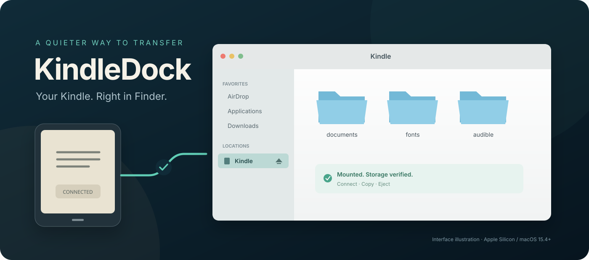

<div align="center">

# KindleDock

**Your Kindle. Right in Finder. Automatically.**

[](https://github.com/LeoooChen/KindleDock/actions/workflows/build.yml)
[](https://github.com/LeoooChen/KindleDock/releases/latest)


[](LICENSE)

[**Download installer ↓**](https://github.com/LeoooChen/KindleDock/releases/latest/download/KindleDock-arm64.pkg) · [简体中文](README.md) · [Build & release](docs/BUILDING.md)



<sub>Native menu bar · Local USB transfer · No account · No Homebrew for users</sub>

</div>

---

Recent Kindles speak MTP, which Finder cannot open natively. **KindleDock mounts supported Kindle storage as a read/write Finder volume**: browse folders, drag books across, rename files and eject normally.

Built on [Antony Vo's kindle-mtp-mount](https://github.com/voantony/kindle-mtp-mount), with automatic mounting, reliable reconnect cleanup, login launch and a complete macOS installer.

## What you get

| Automatic | Verified | Native |
| :--- | :--- | :--- |
| USB arrival/removal notifications | Fresh session after replug; old volume retired first | A real volume under Finder → Locations |
| One attempt per attachment, no USB resets | `documents` must be readable before declaring success | Menu-bar controls and optional login launch |
| Manual eject stays ejected | Read-only mode and bounded readiness checks | App + dependencies in one `.pkg` |

## Quick start

1. Download and run [**KindleDock-arm64.pkg**](https://github.com/LeoooChen/KindleDock/releases/latest/download/KindleDock-arm64.pkg). The installer includes the app, USB/MTP libraries and the required macFUSE runtime. Existing macFUSE 5.5+ is preserved.
2. If prompted, enable macFUSE in **System Settings → General → Login Items & Extensions → File System Extensions**. Approval is manual and required once. No Recovery Mode security changes or kernel-extension enablement are needed.
3. Connect and unlock your supported Kindle. After a few seconds, open **Finder → Locations → Kindle**. Copy compatible books into `documents`.

> [!IMPORTANT]
> Free builds currently have **no Apple Developer ID signature or notarization**. macOS may require you to review and explicitly open the installer from Privacy & Security. KindleDock never disables Gatekeeper or removes quarantine automatically.

Eject in Finder when finished. To read while keeping the cable connected, also tap **Disconnect** on the Kindle screen. Deletes on the Kindle do not go to the Mac's Trash.

## Compatibility

| Requirement | Scope |
| --- | --- |
| Mac | Apple Silicon, macOS 15.4+ |
| Paperwhite 12 / KPW6 | Hardware-tested directory browsing, Chinese filenames, read/write, rename, deletion and replug |
| Colorsoft, 1st generation | Inherited upstream support for the same USB identity; upstream hardware tests |
| USB identity | Only `1949:9981`; this is **not a universal MTP driver** |

Older mass-storage Kindles usually work directly in Finder. Intel and other device identities are not supported by this initial release.

## Downloads

- **`.pkg`**: recommended, app and required runtime in one installer.
- **`.dmg`**: the same installer inside a disk image, with a quick-start note.
- **`.zip`**: app only, for Macs that already have macFUSE 5.5+.
- **`SHA256SUMS.txt`**: release checksums.

[All release files →](https://github.com/LeoooChen/KindleDock/releases/latest)

## Faster discovery, honest measurements

Native IOKit notifications replace the one-second polling loop. Settling is reduced from the prototype's two seconds to **350 ms**. Native `getmntinfo` checks replace shell processes. Idle maintenance runs every 15 seconds as a fallback.

350 ms is **not** a promise of total mount latency: Kindle firmware, USB and macFUSE still take time. Each verified mount logs actual elapsed milliseconds. See [measurement method and boundaries](docs/PERFORMANCE.md).

## Common questions

**Why does Finder show an empty Kindle?** Old USB sessions must not be reused. KindleDock retires the old helper/volume and verifies `documents` on the new one. If verification fails, quit competing transfer apps and reconnect or choose Mount.

**Why no automatic mount?** Check the cable, device identity, unlock state and macFUSE approval. Quit Calibre, OpenMTP and the older Mount Kindle app. Only one MTP client can hold the device. Failed automatic attempts do not loop; use Mount or replug.

**Why does Kindle still say connected after Finder eject?** Eject unmounts the Mac's virtual filesystem. Tap Disconnect on the Kindle or unplug the cable to leave firmware USB mode. [Amazon's instructions](https://digprjsurvey.amazon.com/csad/help/node/TCUBEdEkbIhK07ysFu).

**Will it affect NTFS/Mounty?** These apps can share macFUSE. The installer preserves 5.5+ and never changes NTFS drivers or configuration, but upgrading an older shared runtime still needs validation with your own NTFS workflow. Do not remove shared macFUSE when uninstalling KindleDock.

**Does it convert EPUB or remove DRM?** No. It transfers files only. Use formats supported by your device and content you are entitled to use.

## Build & contribute

```sh
scripts/test.sh
app/build-app.sh
scripts/build-package.sh
```

[Build requirements, signing and release workflow](docs/BUILDING.md) · [Contributing](CONTRIBUTING.md) · [Changelog](CHANGELOG.md)

Actions builds PRs/main and publishes installers when a `v*` tag matches `VERSION`. Code uses MIT; libmtp/libusb retain LGPL; macFUSE has its [own license](packaging/MACFUSE-LICENSE.txt), including restrictions on commercial bundling. See [third-party notices](app/THIRD-PARTY-NOTICES.txt).

Thanks to [Antony Vo](https://github.com/voantony/kindle-mtp-mount), [macFUSE](https://macfuse.github.io/), [libmtp](https://github.com/libmtp/libmtp) and [libusb](https://github.com/libusb/libusb). Original copyright and commit history are retained.

<sub>Unofficial project; not affiliated with Amazon. Header is an interface illustration, not a hardware screenshot.</sub>
