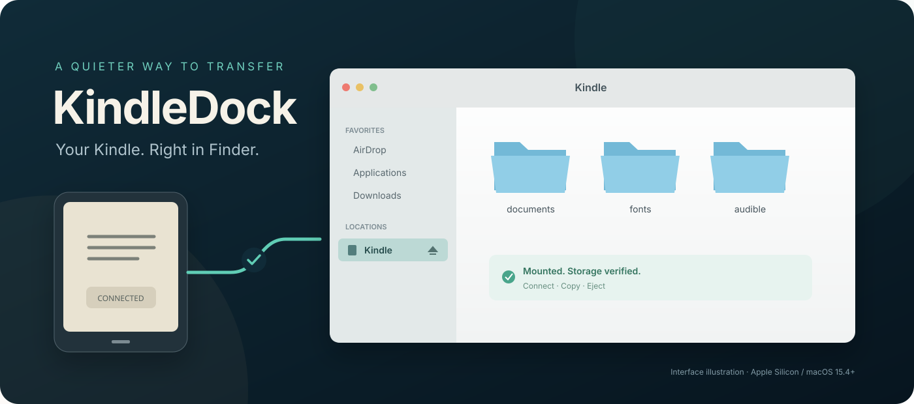

<div align="center">

# KindleDock

**让 Kindle 回到 Finder。插线，自动出现。**

[](https://github.com/LeoooChen/KindleDock/actions/workflows/build.yml)
[](https://github.com/LeoooChen/KindleDock/releases/latest)


[](LICENSE)

[**下载安装包 ↓**](https://github.com/LeoooChen/KindleDock/releases/latest/download/KindleDock-arm64.pkg) · [English](README.en.md) · [快速开始](#快速开始) · [常见问题](#常见问题) · [构建与贡献](docs/BUILDING.md)



<sub>原生菜单栏应用 · USB 本地传输 · 无需账号 · 无需 Homebrew</sub>

</div>

---

新款 Kindle 使用 MTP，macOS 的 Finder 无法直接打开它。**KindleDock 把支持的 Kindle 挂载为 Finder 侧栏里的可读写磁盘**，可以直接浏览文件夹、拖入电子书、复制文件和推出设备。

本项目基于 [Antony Vo 的 kindle-mtp-mount](https://github.com/voantony/kindle-mtp-mount)，补上了自动挂载、重连处理、登录启动和完整安装包。

## 为什么用 KindleDock

| 连接即挂载 | 拔插后仍然可靠 | 日常操作留在 Finder |
| :--- | :--- | :--- |
| 原生 USB 事件通知，不需要每次点 Mount | 清理旧虚拟盘，再为新连接创建新会话 | 支持浏览、复制、重命名、建文件夹和推出 |
| **不是只显示一个空磁盘** | **空闲时保持安静** | **安装包带齐依赖** |
| 挂载后验证 `documents` 可读，才报告成功 | 原生状态检查，15 秒兜底，不反复抢占设备 | `.pkg` 内含应用、MTP/USB 库和所需 macFUSE 组件 |

- **手动推出会被尊重**：推出后保持断开，下一次拔插才自动挂载。
- **只读模式**：只想复制书出来时，可切换为只读。
- **登录时启动**：可在菜单栏开关，不需要手写启动脚本。
- **离线工作**：传输不经服务器，不需要亚马逊账号，不收集遥测。

## 快速开始

### 1. 安装

下载并打开 [**KindleDock-arm64.pkg**](https://github.com/LeoooChen/KindleDock/releases/latest/download/KindleDock-arm64.pkg)，按安装器提示完成安装。应用随后出现在菜单栏。

安装器会安装所需运行环境；**已有 macFUSE 5.5 或更新版本时会保留它**。不会升级 Mounty/NTFS-3G，也不会修改它们的挂载脚本。

> [!IMPORTANT]
> 免费构建版本目前**没有 Apple Developer ID 签名或公证**。如果 macOS 拦截安装，请先核对项目来源和 Release 校验值，再按系统提示到“隐私与安全性”中确认打开此安装包。不会自动关闭 Gatekeeper。

### 2. 完成一次性系统授权

首次使用如提示 macFUSE 未启用，打开：

**系统设置 → 通用 → 登录项与扩展 → 文件系统扩展 → 启用 macFUSE**

此授权需要你亲自完成。使用的是 FSKit 后端，**无需进入恢复模式、降低安全性或开启内核扩展**。

### 3. 插线，打开 Finder

连接并解锁支持的 Kindle，等待几秒，在 **Finder → 位置 → Kindle** 中打开。把兼容格式的书复制到 `documents` 文件夹即可。

完成后在 Finder 中推出。需要继续插线充电并阅读时，再点 Kindle 屏幕上的 **Disconnect／断开连接**。

## 支持范围

| 项目 | 当前范围 |
| :--- | :--- |
| Mac | **Apple Silicon**，macOS **15.4+** |
| Paperwhite 12 / KPW6 | 已在真实设备上验证目录、中文文件名读写、重命名、删除及拔插重连 |
| Colorsoft 第 1 代 | 沿用上游相同 USB 标识的协议支持；上游有实测记录 |
| USB 标识 | 当前只接受 `1949:9981`，**不是通用 MTP 驱动** |
| 旧款磁盘模式 Kindle | 通常可由 Finder 直接打开，不需要本工具 |

当前首次发行只提供 arm64 安装包。其他型号、Intel Mac 和其他 USB 标识尚未承诺支持。

## 下载选哪个

| 文件 | 用途 |
| :--- | :--- |
| **`KindleDock-arm64.pkg`** | 推荐。应用与依赖一起安装，下载链接保持不变 |
| `KindleDock-<版本>-arm64.dmg` | 磁盘映像，内含同一安装器和快速说明 |
| `KindleDock-<版本>-arm64.zip` | 仅应用；适合已安装 macFUSE 5.5+ 的用户 |
| `SHA256SUMS.txt` | Release 附带的下载校验值 |

[查看全部发行文件 →](https://github.com/LeoooChen/KindleDock/releases/latest)

## 菜单栏里有什么

| 选项 | 作用 |
| :--- | :--- |
| Mount / Unmount | 手动挂载或安全卸载 |
| Open in Finder | 打开 Kindle 存储空间 |
| Read-only | 拒绝设备上的写入和删除 |
| Auto-mount on connection | 连接时自动挂载；每次连接只尝试一次 |
| Launch at login | 登录后启动；开发目录中的构建不会创建登录项 |
| Show logs / Help & setup | 查看日志或安装说明 |

## 识别为什么更快

KindleDock 使用 **IOKit 插拔事件**，不再等待一秒轮询；设备稳定等待从原型的两秒缩短为 **350 毫秒**。挂载状态通过系统接口读取，不再启动 `mount` shell 进程。

整体耗时还取决于 Kindle 固件、USB 和 macFUSE 的挂载过程，**350 毫秒不是“挂载完成时间”**。应用会记录每次真正验证存储完成的耗时。测试方法和边界见 [性能说明](docs/PERFORMANCE.md)。

## 常见问题

<details>
<summary><strong>Finder 有 Kindle，但里面是空的？</strong></summary>

KindleDock 会按 USB 连接身份清理旧挂载，并在新挂载后验证 `documents`。若显示 Storage unavailable，请退出其他 MTP 软件后重新连接，或手动选 Mount。报告问题时附上 macOS、Kindle 型号、固件版本和脱敏日志；不要上传电子书或个人信息。

</details>

<details>
<summary><strong>连接后没有出现设备？</strong></summary>

确认数据线支持传输、Kindle 已解锁、型号在支持范围内，并已授权 macFUSE 文件系统扩展。退出 Calibre、OpenMTP、旧的 Mount Kindle 或其他占用设备的软件，再手动点 Mount。KindleDock 不会反复抢占或重置 USB。

</details>

<details>
<summary><strong>Finder 已推出，Kindle 仍显示“已连接计算机”？</strong></summary>

Finder 推出的是 Mac 上的虚拟磁盘，不是切换 Kindle 固件模式。在 Kindle 屏幕点 Disconnect／断开连接，或拔掉线即可。[亚马逊官方说明](https://digprjsurvey.amazon.com/csad/help/node/TCUBEdEkbIhK07ysFu)。

</details>

<details>
<summary><strong>会影响 NTFS、Mounty 或其他使用 macFUSE 的软件吗？</strong></summary>

它们可能共用 macFUSE。安装器保留已安装的 5.5+；若现有版本更旧，会升级共享运行环境。它不修改 NTFS 驱动或配置，但无法替所有第三方软件保证兼容性，重要 NTFS 工作流应在升级后实际验证。卸载 KindleDock 时不要顺手删除共用的 macFUSE。

</details>

<details>
<summary><strong>能直接阅读 EPUB，或者转换/解密书籍吗？</strong></summary>

KindleDock 只负责传文件，不转换格式、不处理 DRM。请使用设备支持的文件格式和你有权使用的内容。

</details>

> [!CAUTION]
> Kindle 上的删除操作**不经过 Mac 废纸篓**。大文件写入需要足够的 Mac 临时空间。正常使用请先推出再拔线。

## 构建、发布与贡献

```sh
scripts/test.sh
app/build-app.sh
scripts/build-package.sh
```

构建环境、完整测试、签名方式和 Release 流程见 [BUILDING.md](docs/BUILDING.md)。GitHub Actions 会在提交和 PR 时构建，推送与 `VERSION` 一致的 `v*` 标签时自动发布安装包。

欢迎提交可复现的设备兼容性反馈。改动前请阅读 [贡献说明](CONTRIBUTING.md) 与 [更新记录](CHANGELOG.md)。

## 致谢与许可

- [Antony Vo / kindle-mtp-mount](https://github.com/voantony/kindle-mtp-mount)：原始文件系统、MTP 实现与菜单栏应用。保留原始提交历史和 MIT 版权。
- [macFUSE](https://macfuse.github.io/)：通过 FSKit 提供 Finder 文件系统。
- [libmtp](https://github.com/libmtp/libmtp) 与 [libusb](https://github.com/libusb/libusb)：USB/MTP 通信。

KindleDock 自有代码使用 [MIT](LICENSE) 许可。libmtp/libusb 使用 LGPL；**macFUSE 使用单独许可，商业软件捆绑分发有额外限制**，详见 [第三方说明](app/THIRD-PARTY-NOTICES.txt) 和 [macFUSE 许可](packaging/MACFUSE-LICENSE.txt)。

<sub>本项目非 Amazon 官方产品，与 Amazon 无隶属关系。封面为界面示意，不是实机截图。</sub>
